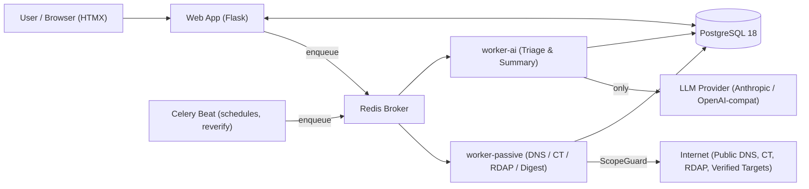

<div align="center">

# attacksurf

**Open-source, AI-powered attack surface management (ASM)**

Discover your internet-facing assets, find DNS and security misconfigurations before attackers do,
and let AI explain what matters, self-hosted and free.

[](https://github.com/cpt9m0/attacksurf/actions/workflows/ci.yml)
[](LICENSE)
[](https://www.python.org/)
[](https://github.com/astral-sh/uv)
[](https://github.com/astral-sh/ruff)
[](CONTRIBUTING.md)
[](https://github.com/sponsors/cpt9m0)

[Features](#features) · [Architecture](#how-it-works) · [Quick start](#quick-start) · [Docs](docs/README.md) · [Roadmap](#roadmap) · [Contributing](#contributing) · [Sponsor](#sponsor-attacksurf)

</div>

---

> **v0.1.0 MVP:** External DNS attack surface monitoring with CT subdomain discovery, DNS
> hygiene and takeover checks, AI triage and exposure summaries, scheduled rescans, and email
> digests. Follow the [roadmap epic](https://github.com/cpt9m0/attacksurf/issues/31) or
> [pick an issue](https://github.com/cpt9m0/attacksurf/issues).

## What is attacksurf?

Your **attack surface** is everything an attacker can reach from the internet: domains,
forgotten subdomains, DNS records, exposed servers, websites, leaked code. **attacksurf**
continuously maps it and checks it for weaknesses: **external attack surface management (EASM)**
for small teams, startups, students, and self-hosters who can't afford commercial ASM platforms.

Scanners find the issues; an LLM (Anthropic Claude or any OpenAI-compatible model, including your
own key) **triages, prioritizes, and explains** them in plain language with fix steps.

## Features

### Domains & DNS (MVP)
- **Subdomain enumeration** from Certificate Transparency logs, with wildcard DNS detection
- **DNS resolution**: A/AAAA/CNAME/MX/NS/TXT/CAA/SOA records, CNAME → IP chains, IP assets
  with reverse DNS and offline ASN/organisation, and non-resolving subdomain tracking
- **Subdomain takeover detection**: dangling CNAMEs and NS records pointing to unclaimed cloud services
- **Email security**: SPF, DMARC, DKIM, MTA-STS checks (is your domain spoofable?)
- **DNS hygiene**: DNSSEC, nameserver and MX configuration, CAA, zone transfer (AXFR) exposure
- **Domain expiry** monitoring via RDAP
- **Codebase upload** (early): upload a source archive; it is stored encrypted and queued for analysis (analyzers are coming)
- **Binary and mobile app upload** (early): upload an ELF, PE or Mach-O executable, an APK or an IPA; it is identified by its SHA-256, stored encrypted, never run, and queued for analysis (analyzers are coming)
- **Asset inventory**: add the domains you own, then browse everything discovered under them
  (filters, search, open findings per asset) and the asset graph: domain → subdomain → CNAME → IP
- **Scan control**: start a scan from the UI or the API, watch its progress live, cancel it,
  and review what changed (new / fixed / regressed findings, new and disappeared assets)
- **Findings triage**: the findings list filtered by severity, status, rule, asset and root
  domain (or only what the latest scan found), a detail page with the escaped evidence,
  remediation and timeline, accept-risk / false-positive decisions with a required comment,
  bulk actions, CSV/JSON export, and a dashboard with open findings by severity, the newest
  ones and each root's last scan

### Platform
- **AI triage & exposure summaries**: after each scan, an LLM judges every new or changed finding
  (severity in context, false-positive likelihood, P1 to P4 priority and fix steps) and then
  writes a plain-language exposure summary (headline, top risks linked to real findings, sensitive
  hosts flagged with the `notable` tag, changes since the last scan, and next actions) shown on
  the scan page and dashboard. Every output is labeled as AI-generated, never changes a finding,
  never fails a scan, stays within each org's monthly token budget and never pays twice for an
  unchanged finding or already-summarized scan
- **Continuous monitoring**: per-domain daily or weekly rescans of read-only DNS configuration
  checks, with an admin opt-out and the same new / fixed / regressed diffs
- **Bring your own LLM**: Anthropic or any OpenAI-compatible endpoint (OpenAI, OpenRouter, vLLM, ...)
- **Safe by design**: ownership verification before any active check, SSRF protection, no exploitation
- **Self-hosted**: one `docker compose up` on a single VPS; your data stays with you
- **Multi-user ready**: organizations and roles

### Coming next
Website scanning (TLS, headers, exposed files, outdated software) ·
Codebase scanning (secrets, SAST, vulnerable dependencies) · Binary and mobile app analysis ·
IP / VPS exposure (open ports, service CVEs)

## Quick start

**Self-hosting in production:** deploy prebuilt GHCR images or build from source behind Caddy or
Cloudflare Tunnel — see the [self-hosting guide](docs/self-hosting.md) and
[deployment runbook](docs/deployment.md).

**With Docker (local dev):** web app + PostgreSQL + Redis + Mailpit in one command.

```bash
git clone https://github.com/cpt9m0/attacksurf.git
cd attacksurf
cp .env.example .env
make up        # build, migrate, start  →  http://127.0.0.1:5000
make logs      # follow logs; `make` lists all targets; `make down` to stop
```

Open the app and sign up with your email and a password; there are no default credentials.

On Linux, a Docker socket `permission denied` error usually needs a login/group refresh;
see [Docker permissions](docs/development.md#docker-permissions-on-linux) before changing permissions.

**Without Docker:** just the web app.

```bash
uv sync
cp .env.example .env
uv run flask --app attacksurf run --debug   # http://127.0.0.1:5000
```

Contributors: also run `uv run pre-commit install` (see [CONTRIBUTING.md](CONTRIBUTING.md)).

**Production:** one VPS behind a Cloudflare Tunnel, no inbound ports: see
[docs/deployment.md](docs/deployment.md).

## How it works



```
 Add domain ─► Discover (CT logs, DNS) ─► Check (takeover, email, DNSSEC, ...) ─► Diff vs last scan ─► AI triage & summary ─► Email digest
```

Flask + HTMX web app, Celery workers, PostgreSQL, Redis. Each check is a small plugin, so
**adding a new check is a great first contribution**.

- [Architecture overview](docs/architecture.md)
- [Scanners & rule catalog (25 rules)](docs/scanners.md)
- [Writing a scanner plugin](docs/writing-a-scanner.md)
- [Self-hosting guide](docs/self-hosting.md)
- [Security model](docs/security.md) & [Responsible use policy](docs/responsible-use.md)

## Roadmap

| Phase | Scope | Status |
|---|---|---|
| 1 | Foundation: tooling, DB, auth, UI shell | ✅ v0.1.0 |
| 2 | Scan engine: plugins, pipeline, ScopeGuard | ✅ v0.1.0 |
| 3 | DNS module (CT discovery, resolution, email, takeover, DNSSEC/NS/MX/CAA/RDAP/AXFR) | ✅ v0.1.0 |
| 4 | AI triage and exposure summaries | ✅ v0.1.0 |
| 5 | Scheduling, email digests, prod hardening → **v0.1.0** | ✅ v0.1.0 |
| next | Website ([#66](https://github.com/cpt9m0/attacksurf/issues/66)), codebase ([#67](https://github.com/cpt9m0/attacksurf/issues/67)), binary ([#68](https://github.com/cpt9m0/attacksurf/issues/68)), IP scanning | 🚧 in progress |

Full plan: [epic #31](https://github.com/cpt9m0/attacksurf/issues/31).

## Contributing

Contributions of all sizes are welcome: new checks, bug reports, docs, UI, ideas.

1. Read [CONTRIBUTING.md](CONTRIBUTING.md)
2. Pick a [`good first issue`](https://github.com/cpt9m0/attacksurf/labels/good%20first%20issue) or any unblocked issue from the [roadmap](https://github.com/cpt9m0/attacksurf/issues/31)
3. Open a PR

AI-assisted contributions are welcome too. The repo ships with [AGENTS.md](AGENTS.md), Claude Code
skills, and MCP config so coding agents follow the project's rules.

## Sponsor attacksurf

attacksurf is free and open source, and we want to keep it that way. Sponsorships pay for:

- **Hosting** a free public instance and a demo
- **API costs** (LLM tokens, threat-intel data sources) for the free tier
- **Maintainer time** for reviews, security fixes, and new scanners

<a href="https://github.com/sponsors/cpt9m0"></a>
<a href="https://ko-fi.com/cpt9m0"></a>

Companies: sponsoring gets your logo here. See [docs/sponsors.md](docs/sponsors.md).

## Responsible use

attacksurf is a **defensive** tool. Only scan assets you own or are authorized to assess. Active
checks require proof of domain ownership, and the project will not add exploitation, brute-force,
or DoS features. See the [responsible-use policy](docs/responsible-use.md) and
[security model](docs/security.md).

Found a vulnerability in attacksurf itself? Please report it privately: [SECURITY.md](SECURITY.md).

## License

[GNU AGPL v3.0](LICENSE). Free to use, modify, and self-host. If you run a modified version as a
network service, you must share your changes under the same license.

### Data attribution

Vulnerability intelligence uses data from the CISA Known Exploited Vulnerabilities (KEV) catalog,
FIRST EPSS, and the National Vulnerability Database (NVD). This product uses data from the NVD API
but is not endorsed or certified by the NVD.

---

<div align="center">

If attacksurf is useful to you, please ⭐ **star the repo**: it helps others find it.

</div>
