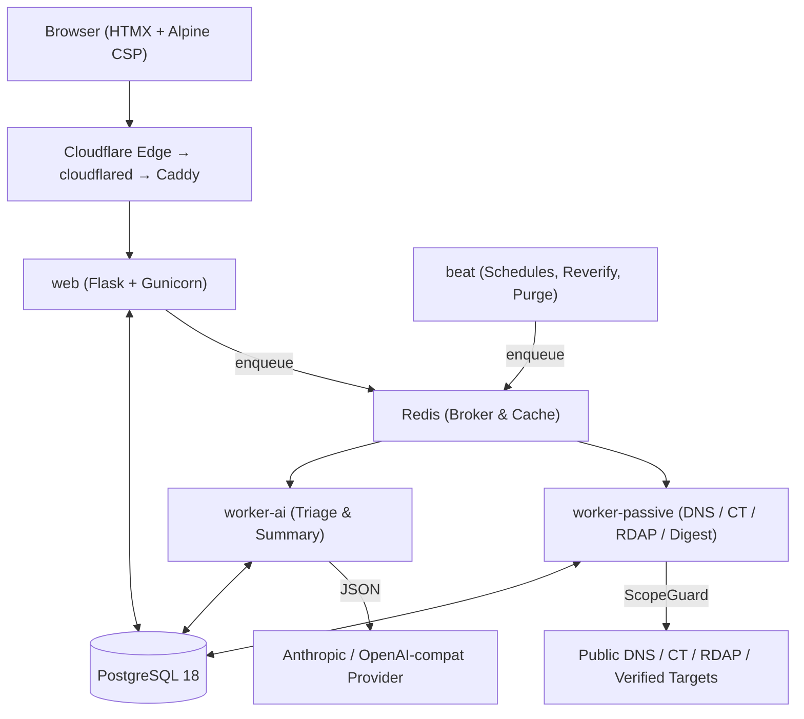
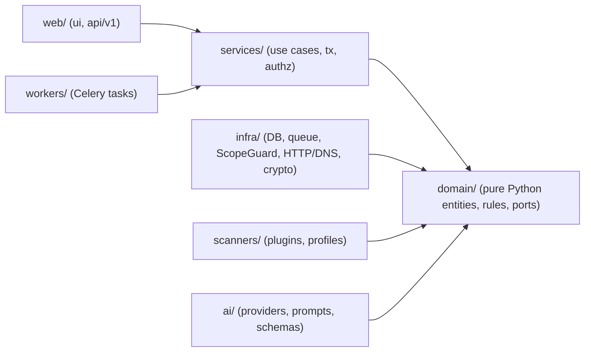
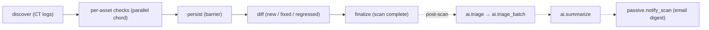

# Architecture

Status: **`v0.1.0` MVP shipped** (DNS discovery & checks, findings lifecycle & diffs, AI triage &
exposure summaries, scheduled rescans, email digests, and single-VPS deployment). Sandbox code/binary
analysis (`worker-analysis`, `sandbox-launcher`, `sandbox-proxy`) is built behind the opt-in dev
`sandbox` profile ahead of #87/#92/#101; see the [roadmap epic](https://github.com/cpt9m0/attacksurf/issues/31).

## Overview

attacksurf is a **modular monolith**: one Flask codebase, deployed as several processes
(web, Celery workers, beat) on one VPS with Docker Compose.



Analysis path (ADR 0016; dev only until #92, ADR 0031): only `sandbox-proxy` holds the Docker
socket, and the sandbox that reads the artifact has no network and no credentials. Compose runs
the chain behind the opt-in `sandbox` profile (`docker compose --profile sandbox up -d --wait`).
`worker-analysis` is on `default` (Postgres, Redis) and on the internal `sandbox` network, which
has no route outside and no Postgres or Redis; the launcher and proxy are on `sandbox` only, and
get no `.env` file, database URL or encryption key. `compose.prod.yaml` has none of these
services.

```
worker-analysis ─ run(artifact ID, analyzer) ─► sandbox-launcher ─► sandbox-proxy ─► Docker
(DB/Redis creds,                                (no credentials)    (only socket holder, │
 never opens artifacts)                                              checks each create) │
        ▲                                                                                │ starts
        └──── JSON on stdout, ≤ 2 MiB, via launcher ◄──── gVisor sandbox, one per job ◄──┘
                                                          no network · read-only /input
                                                          tmpfs /scratch · CPU/mem/pids/time caps
```

### Sandbox launcher

`sandbox_launcher/` is `sandbox-launcher` (`python -m attacksurf.sandbox_launcher`). It has no
DB, Redis or Docker credentials. Each part refuses rather than guesses:

- `config.SandboxLauncherSettings`: process env only (no `.env`, no app secrets); the proxy URL
  may embed credentials, so it is a `SecretStr` unwrapped only where connecting, and must be
  plain `http://` with a host; wall time is at most 840 s, below the proxy's 900 s, so
  the launcher's own kill fires first; `runc` is refused in prod.
- `catalog.py`: each analyzer's command and limits are code, its image digest comes from
  `sandbox-images.lock`; `load_catalog` keeps only analyzers present in both. `CATALOG` is empty
  until the first analyzer ships.
- `artifacts.py`: `resolve_artifact` returns `{root}/{uuid}` only if it is a real directory
  directly inside the root, never a symlink; `ArtifactNotFound` never names the path.
- `container.py`: `build_create_body` is the one place the ADR 0016 create body is spelled out;
  tests run every body through the real `sandbox_proxy.policy.validate_create`.
- `stream.py`: `read_stdout` demultiplexes Docker's attach frames, keeps stdout and drops stderr.
  It caps stdout at 2 MiB (ADR 0011) on each frame's *declared* size, before the payload is
  read, and raises on a cut-off or unknown frame, so partial output is never returned.

The package imports nothing from the app or `sandbox_proxy` (import-linter). The values it
shares with them (proxy limit ceilings, the digest pattern, create-body constants,
`MAX_STDOUT_BYTES`) are copies that unit tests keep equal. The service around them:

- `proxy.py`: `ProxyClient`, the launcher's only way to Docker. One connection per call; replies
  are parsed strictly and errors carry the stage and status only. Attach is a raw socket because
  the proxy relays a hijacked stream.
- `runner.py`: `run_sandbox` creates the container, arms the removed-wait on a thread (before
  start, since `AutoRemove` deletes the container at exit), attaches, starts, and reads stdout
  against a wall-time deadline. It returns `RunOutcome(exit_code, stdout, timed_out,
  output_exceeded)`; anything unexplained raises `SandboxRunFailed`.
- `server.py`: `ThreadingHTTPServer` with `GET /healthz` and `POST /runs`. The body is exactly
  `{"analyzer", "artifact_id"}` (canonical lowercase UUID, 1 KiB cap); the reply is
  `{exit_code, stdout_b64, timed_out, output_exceeded}`. Unknown analyzer or artifact is 404, a
  busy launcher (`SANDBOX_MAX_CONCURRENT_RUNS` slots) or a failed run is 503, with fixed messages.
- `__main__.py`: asks the proxy's `GET /info` for runtime names (ADR 0023) and picks the runtime
  once (`select_runtime`): `runsc`, or `runc` only outside prod with `SANDBOX_ALLOW_RUNC=true`.
  Otherwise it exits non-zero. The empty catalog is allowed, so every run is a 404 until the
  first analyzer ships.

### Sandbox client

`infra/sandbox.py` is the worker's side of the launcher: `LauncherSandboxRunner` implements
`domain.sandbox.SandboxRunner` over `POST /runs`. `workers.runtime.sandbox_runner()` builds it from
`SANDBOX_LAUNCHER_URL` (cached, reset in each forked worker) and `scanner_gate()` hands it to the
scope guard, which still limits each scanner to its granted analyzers. With the URL unset the
gate gets `UnconfiguredSandboxRunner`, so every sandbox request is refused.

- Plain `httpx.Client`, not the SSRF-guarded one: the launcher is on the internal network and its
  URL is operator config (validated as `http://host[:port]` only), never scanner or user input.
- The reply is capped at 3 MiB (base64 of a full 2 MiB stdout plus the JSON wrapper), never
  inflated, and must have exactly the four expected keys with the right types.
- 503 and network failures raise `TransientJobError` (retried); 404, 500 and an invalid reply raise
  `SandboxError`. Messages are fixed text.

### Sandbox tools

`sandbox_tools/` is the code analyzer images ship and run *inside* the sandbox. It uses the
standard library only (a test checks every import; an import-linter contract also names the
app and its dependencies) and the app never imports it. No image or catalog entry uses it yet (#84).

- `extract.py`: `extract_archive(archive, dest)` unpacks one zip or tar(.gz/.bz2/.xz), detected
  by magic bytes, into a new directory under the rules and caps of ADR 0017. `zipfile` and
  `tarfile` only parse; the module copies every byte, counts it as it is written and never
  creates a link. It returns a `Manifest` (files with path, size and SHA-256; skipped entries
  with a reason; totals) or raises `ArchiveRejected` with a fixed reason code and removes the
  partial tree.
- Command line: `python -m attacksurf.sandbox_tools.extract /input/artifact /scratch/src`. It
  writes the full manifest to `/scratch/src.manifest.json` (or `--manifest <path>`) and prints
  one bounded JSON line: counts and the first 50 skipped entries (exit status 0),
  `{"status": "rejected", "reason": ...}` when the artifact is refused (3), or
  `{"status": "error", "reason": "io_error"}` when the extractor itself failed, for example an
  unreadable input or an existing destination (4). Status 1 or 2 with no JSON is a crash or a
  usage error. The summary is bounded because stdout is capped at 2 MiB and a manifest of
  100,000 files is larger.
- A sandbox run is one container with one fixed command, so each analyzer's `AnalyzerSpec.command`
  will be a wrapper in its image: extract `/input/artifact` to `/scratch`, stop with the
  rejection if there is one, otherwise run the tool on the tree and report the skipped entries
  with its results. Images must set `PYTHONDONTWRITEBYTECODE=1`; the proxy allows no `Env`.

- `detect.py`: `detect_binary(path)` names one binary's format by content (#101): `elf`, `pe`,
  `macho`, `macho_fat`, `apk` or `ipa`, with a few header facts (bitness, byte order, machine
  or CPU type, slice or entry count: numbers and fixed words only, never bytes of the file).
  It reads fixed-size headers and a zip's central directory, which may be at most 4 MiB and
  50,000 entries (a larger one is refused whole, never judged on a part);
  it never decompresses, decrypts or executes anything, opens the file with `O_NOFOLLOW` and
  refuses non-regular files. PE needs a valid `e_lfanew` and `PE\0\0`; a universal Mach-O
  needs 1 to 16 slices that lie inside the file, which also excludes Java class files (same
  magic, version word of 45 or more); an APK lists `AndroidManifest.xml` at the top level, an
  IPA a `Payload/<name>.app/` entry, and a zip with both is refused (`ambiguous_zip`) so a
  polyglot cannot pick its analyzer. The zip end record must be the last one whose comment
  ends exactly at the end of the file, and its entry count and directory size must match the
  entries found (`bad_header` otherwise); zip64 end records are refused. Command line:
  `python -m attacksurf.sandbox_tools.detect /input/artifact` prints one JSON line with the same exit
  statuses as `extract`: 0, 3 (`unknown_format`, `truncated`, `bad_header`, `no_zip_end`,
  `not_apk_or_ipa`, `ambiguous_zip`, `zip_too_large`), 4 (`io_error`). The binary corpus in `tests/fixtures/binaries/` (header
  stubs, not programs) is generated by `uv run python -m tests.binary_fixtures`.

The corpus in `tests/fixtures/archives/` (zip-slip, link escapes, bombs, device nodes, header
mismatches, truncations) is generated by `uv run python -m tests.archive_fixtures`.

## Layers



- `domain` depends on nothing. `services` orchestrate domain + adapters. `web` and `workers` are
  thin entry points.
- Pragmatism over purity: SQLAlchemy models live in `infra/db`; the Repository pattern is only
  added where it simplifies testing.
- **Enforced**: import-linter contracts in `pyproject.toml` fail the build if `domain` imports
  another layer (or Flask/SQLAlchemy/structlog), or if any inner layer imports `web`/`workers`.

## App, config, logging

- `create_app(settings=None)` (`app.py`) builds the Flask app from a `Settings` object and
  registers blueprints: `ui` (`/`), `health` (`/healthz`, liveness only), `api_v1` (`/api/v1`).
- `Settings` (`config.py`, pydantic-settings) reads env vars and `.env`. `ENV=prod` requires a
  `SECRET_KEY` of ≥ 32 characters that isn't a known placeholder; dev/test fall back to an
  ephemeral key with a warning. Secrets and connection URLs are `SecretStr`.
- Logging (`infra/logging.py`): structlog **and** stdlib logging (Flask, Werkzeug, libraries)
  share one pipeline: JSON in prod, console in dev/test; every line carries the request's
  `request_id` (from a valid `X-Request-ID` header or generated, echoed back in the response);
  keys that look like secrets are redacted.
- `import attacksurf.domain` (or any inner layer) never loads Flask: the package re-exports
  `create_app` lazily.

## Database

- SQLAlchemy 2.0 + Alembic, no Flask extensions (ADR 0008). Code in `infra/db/`: `base.py`
  (declarative `Base`, constraint naming convention, mixins), `models.py`, `session.py`
  (engine + session factory from `Settings`), `tenancy.py`, `migrations/`.
- Mixins: `UUIDPrimaryKey` (UUIDv7, `domain/ids.py`), `Timestamps` (`created_at`, `updated_at`,
  DB-side `now()`), `TenantScoped` (UUID key + `org_id` → `orgs.id`, NOT NULL, indexed,
  `ON DELETE CASCADE`).
- Tenant rows are read only via `scoped(Model, org_id)` (a `Select` with the org filter) or
  `get_scoped(session, Model, id, org_id)` (returns `None` for another org's row).
- Sessions: one per request in `web` (`web.db.get_session()`, closed at teardown); Celery
  tasks open `with runtime.session_factory()() as session:` (one factory per worker
  process). Services commit.
- import-linter: `web` (except `web/db.py`), `scanners`, `ai` never import SQLAlchemy/Alembic.
- Services are verb functions (`register_user(session, ...)`): they validate with pure `domain`
  rules, take adapters through `domain` protocols (e.g. `PasswordHasher`, implemented by
  `infra.crypto.Argon2PasswordHasher`), commit once, and raise domain exceptions
  (`InvalidSignup`, `EmailAlreadyRegistered`) that `web` maps to responses.

## Core model

| Entity | Purpose |
|---|---|
| `Org`, `User`, `Membership` | tenancy; every tenant row carries `org_id`. `User` is global (one login, many orgs); `Membership.role` is `owner`/`admin`/`member` (`domain.accounts.has_role`) |
| `Asset` | polymorphic target: `domain`, `subdomain`, `ip`, `url`, `repo`, `binary`; one row per `(org_id, type, value)` with `value` normalized by `domain.assets.normalize_asset_value` (hostnames lowercase punycode via `idna`, canonical IPs, `http(s)` URLs without credentials/fragment/default port; repos as `host/owner/name` or `upload/<slug>`; binaries as `sha256:<64 lowercase hex>` of their bytes); `source` user/discovered, `parent_id` = asset a discovered one was found under (set once at first sighting, so no cycles; user-added assets are roots; deleting a parent cascades to its discovered children), `first_seen`/`last_seen`, `first_seen_scan_id` + `deactivated_by_scan_id` (which scan discovered/deactivated it, so an overlapping scan's diff cannot claim it), `is_active` + `deactivated_at` (only sightings after it reactivate), `tags`, `details` (a JSONB bag for scan-derived metadata: CT discovery stores `{"wildcard": true}` on wildcard zones; DNS resolution stores `dns` records/chain and `ip` PTR/ASN/organisation, plus an `observed_at` marker so stale scans cannot replace newer details, ADR 0025). Roots come from `services.assets.add_root_domain` (any name `check_public_hostname` accepts, registrable or subdomain; re-adding an archived root restores it) and are removed only by `archive_root_domain` (root + its discovered children go inactive; findings and scans are kept) |
| `AssetRelation` | graph edges: `subdomain_of`, `cname_to`, `resolves_to`, `serves`; unique per `(org_id, from, to, kind)`, no self-edges. `services.assets.record_asset` / `record_relation` upsert atomically (`INSERT … ON CONFLICT`): re-seen rows extend `last_seen`, never downgrade `source=user`, don't commit (the pipeline commits once), and raise `AssetNotFound` for a parent or endpoint that isn't the org's (locked `FOR KEY SHARE` so it can't vanish before the insert) |
| `Verification` | proof of ownership of a root domain (`_attacksurf-verify.<root>` TXT, `pending`/`verified`/`revoked`, `verified_at`, `last_checked_at`, `recheck_at`, `expires_at`; unique per `(org_id, asset_id)`). Renewals are due after 20 hours; authorization expires after 24 hours. Subdomains inherit their root's proof; a `verified` row counts only while `expires_at` is in the future. Written by `services.verifications` / `services.ownership`, read by `DbOwnershipChecker` (ADRs 0014, 0015) |
| `Scan`, `Job` | one run of a profile (`dns_passive`, …) against a root asset (`queued/running/completed/failed/cancelled`, triggered by `user`/`schedule`; `stats` holds the #20 diff: new/fixed/regressed findings by severity and new/disappeared assets, ADR 0027; `ai_summary` holds the #26 `StoredSummary`, ADR 0030), and its jobs: a pipeline stage, or one scanner on one asset (`skipped` = not run, e.g. denied by ScopeGuard). `scan_id` is NULL for work that isn't part of a scan (ownership verification). Deleting the root asset deletes its scans (their jobs are kept with `scan_id` NULL); deleting another asset keeps the job with `asset_id` NULL |
| `Finding`, `Evidence` | normalized result, one row per issue across scans: unique `(org_id, fingerprint)`, with `fingerprint = domain.findings.finding_fingerprint(org_id, asset_id, rule_id, location)` (SHA-256 of a versioned JSON array; `location` tells apart several issues of one rule on one asset). `rule_id` points into the rule catalog (`domain.rules`: title, default severity, remediation template, references). `scanner` is the `Job.scanner` that last observed it (`NULL` before #20: never auto-fixed), and `evidence_digest` is the SHA-256 of the last observed evidence set (empty included) for material-change checks. Status `open → fixed → regressed → fixed` (the diff stage `services.scan_diff` owns those transitions, ADR 0027), plus the user's `accepted_risk`/`false_positive`, which reopen to `open` only on a material change; `fixed_at` is set exactly when `fixed`. `FindingObservation` records one row per `(scan, finding)` with the severity at observation time: it is what a scan's own stats and fix/regress decisions use, so they never depend on the mutable `last_seen_scan_id`; rows cascade with their scan and finding. Deleting a scan keeps its findings (scan references become NULL); evidence (`dns_record`/`http_response`/`raw`) goes with its finding |
| `Artifact` | an uploaded or fetched repo/binary of an asset, stored encrypted (#85, ADR 0028): `kind` (`repo`/`binary`), plaintext `sha256` + `size_bytes`, `storage_key` (`{org_id}/{artifact_id}`), `key_envelope` (the per-artifact AES key wrapped by `APP_ENCRYPTION_KEY`; NULL exactly when `deleted_at` is set, enforced by a CHECK), `delete_after`. `services.artifacts`: `store_artifact` (streams through the `domain.artifacts.ArtifactStore` port, per-artifact limit and per-org quota, audited), `open_artifact`, `stage_artifact`, `delete_artifact` (file removed, key erased, row kept), `purge_expired` (beat, every 10 min; a failed deletion keeps the key and is retried behind everything still waiting). `infra.storage.LocalArtifactStore` writes ciphertext to `ARTIFACT_STORE_ROOT/{org}/{artifact}` (0700/0600, temp file + `os.replace`; staging and deletion of one artifact are serialised by a `flock` on `{artifact}.lock` there) and stages plaintext for one sandbox run at `SANDBOX_ARTIFACT_ROOT/{artifact}/artifact`; the two roots may not overlap. Deleting the asset or org cascades the row, which erases the key. Nothing stages yet: the caller is #84's decision |
| `LLMUsage` | one row per finished LLM call, successful or not: provider, model, `purpose`, `key_source` (`org`/`instance`), input/output tokens, `usage_reported`, `estimated_cost_usd` (snapshotted from `ai/pricing.py` list prices; NULL for an unpriced model or unreported usage), latency (NULL on failure), `success` + `error_type` (class name only). Append-only; indexed by `(org_id, created_at)` for #24's monthly instance-key cap. Written by `services.llm_usage.record_llm_usage` |
| `OrgSettings` | one row per org (`UniqueConstraint("org_id")`): `ai_enabled`, `provider`, `model`, `base_url`, AES-256-GCM encrypted API key (`SecretCipher`, AAD `org_id`) + `api_key_last4`, optional `monthly_token_budget`. Written by `services.org_settings` |
| `ScanSchedule` | one recurring-scan preference per root (`UniqueConstraint("org_id", "root_asset_id")`, same-org FK): `profile` (only `dns_scheduled`), `frequency` (`daily`/`weekly`), `enabled` + `next_run_at` (a CHECK keeps them consistent), indexed for the minute tick. `services.scan_schedules.seed_schedule` inserts the registration default (`SCAN_DEFAULT_FREQUENCY`, weekly unless configured otherwise) without overwriting a restored root's saved preference; `save_schedule`/`get_schedule` are the tenant-scoped read/write use cases. Not a history table: scans keep the trigger (`schedule`) and outcome |
| `NotificationPreference`, `NotificationDelivery` | per-user email digest settings in an org (`email_enabled`, `min_severity`; defaults `true`/`high` when absent) and at-most-once delivery records per `(org_id, scan_id, user_id)` (#28, ADR 0032) |
| `VulnCve`, `VulnCpeRange`, `VulnSyncState` | **global read-only reference store (explicit exception to `org_id` / `TenantScoped`, ADR 0006)**: synced daily by `passive.vulnintel_sync` from NVD CVE 2.0, CISA KEV, and FIRST EPSS (`services` grant: `services.nvd.nist.gov`, `www.cisa.gov`, `api.first.org`); `services.vulnintel.match_product(vendor, product, version)` matches inclusive/exclusive/missing CPE bounds (#74). Uses NVD public domain data (*not endorsed or certified by the NVD*), CISA KEV (public domain), and FIRST EPSS telemetry |
| `AuditLog` | append-only trail of security-relevant actions (`services.audit.audit()`, written in the same transaction as the change) |

## Scan pipeline



- AI work starts only after `finalize` commits the scan as completed (ADR 0029): `finalize_scan`
  queues one `ai.triage` job, so an LLM outage or a spent budget never delays or fails a scan.

- Implemented as a Celery `chain`/`chord`; each stage is idempotent and tracked as a `Job`.
- **Scanners are plugins** (`@register_scanner`) returning normalized pydantic `ScanOutput`.
  A scan **profile** (e.g. `dns_passive`) selects the scanners to run.
- A failing scanner fails only its job, not the scan.
- Implemented framework (ADR 0011/0013): `domain/scanners.py` defines pydantic `ScanOutput`,
  `AssetRef(type, value)`, relations, raw rule findings/evidence, `AssetObservation` details,
  `ScanContext`, the `Scanner` protocol, the frozen `ScannerGrant` and `ScannerRuntime`
  (validated DNS/HTTP adapters, raw record lookups, the run cache, offline IP intel and the
  grant-checked sandbox port from `domain/sandbox.py`). Plugins
  declare `name`, `asset_types`, `queue`, `requires_verification`, `timeout_seconds`
  (0 < timeout <= 240 s) and `grant`, and return `run(ctx, asset) -> ScanOutput`.
  `ScanOutput.wildcard_zones` marks assets that are wildcard DNS zones rather than hosts; a
  discovery profile's cap reaches the plugin through `ScanContext.max_discovered_assets`.
  `ScanOutput.observations` carries per-asset details and lifecycle claims; persistence merges
  the details and may deactivate only discovered assets.
- `scanners/registry.py` supplies `@register_scanner`; `workers/app.py` and `app.create_app`
  import production plugin modules explicitly, so each process registers them once.
  `scanners/profiles.py`
  selects discovery/check plugins by name. `dns_passive` runs `dns.discovery.ct` for discovery
  and `dns.resolve`, `dns.email`, `dns.takeover`, `dns.takeover.http`, `dns.dnssec`, `dns.ns`,
  `dns.mx`, `dns.caa`, `dns.whois` and `dns.axfr` for checks, with `max_discovered_assets=1000`;
  `web_active` runs `web.probe` on the `active` queue (`max_discovered_assets=1000`) to probe
  `https://` then `http://` on active verified hosts and refresh discovered `url` assets (#72);
  empty/unknown profiles are rejected. `WORKER_PROFILES` also carries the background-only
  `dns_scheduled` profile (`dns.resolve`, `dns.email`, `dns.dnssec`) for recurring scans,
  with the same `MAX_DISCOVERED_ASSETS` cap as `dns_passive` because `dns.resolve` still emits
  new IP/CNAME assets; it is deliberately absent from `PROFILES`, so no UI/API route can select
  it. Profiles route each scanner to its declared `queue` (`passive` or `active`); a unit test
  keeps analysis scanners out of every profile until #92 (ADR 0031).
- **CT discovery (#15, ADR 0022):** `dns.discovery.ct` queries crt.sh's JSON endpoint and falls
  back to Cert Spotter when crt.sh fails, times out or truncates. Names are normalized, filtered
  to the root, deduplicated and capped (shallow names first). Complete results are cached per
  root in Redis for six hours through `ctx.runtime.cache`; failures are misses, never job
  failures. A bounded number of random-label DNS lookups (`ctx.runtime.dns`) detects wildcard
  zones, and detected zones are persisted as `Asset.details["wildcard"] = true`. When both
  sources fail the scanner raises `TransientJobError`, so Celery retries with backoff.
- **DNS resolution (#16, ADR 0025):** `dns.resolve` queries A, AAAA, CNAME, MX, NS, TXT, CAA
  and SOA through the configured public resolvers, follows CNAMEs up to five hops, resolves the
  terminal name, and stores capped records in `Asset.details["dns"]`. A/AAAA answers create IP
  assets and `resolves_to` edges; in-root CNAME hops create `cname_to` edges (external targets
  stay in `cname_chain`). Reverse DNS and an optional offline ip2asn database fill
  `Asset.details["ip"]`; private/special-purpose addresses emit the info finding
  `dns.records.private_ip_exposed`. A discovered subdomain with no records becomes inactive;
  roots/user assets and wildcard-marked zones are never deactivated. A partial lookup failure
  withholds the DNS details replacement (and a failed PTR lookup withholds that IP's `ip`
  subtree), so the last complete observation stays; NUL bytes in TXT values are stored as `\0`
  because PostgreSQL JSONB rejects U+0000. `Asset.details["observed_at"]` orders observations,
  so a delayed older result cannot replace newer details.
- **Email security (#17):** `dns.email` is a check-only plugin on root domains (no assets,
  relations or observations) that reads TXT records for the apex, `_dmarc`, `_mta-sts` and common
  `<selector>._domainkey` names in one `lookup_many` round and evaluates SPF (missing,
  multiple, permissive `+all`/`?all`, >10 reachable DNS-querying terms), DMARC (missing —
  including multiple records, monitor-only, no reporting, partial `pct`), DKIM (no common
  selector publishes a usable key; low confidence) and MTA-STS (missing, info). A scanned
  name without a usable DMARC record falls back to its organizational domain's record
  (`ScannerRuntime.org_domain`, fed by the ScopeGuard's public-suffix classifier), whose
  `sp` policy then applies; an invalid `p`/`sp` is read as `p=none` when a valid reporting
  URI exists, per RFC 7489. Evidence is the raw
  TXT records as `dns_record` evidence. A failed query fails open (that check is skipped);
  only an all-error run raises `TransientJobError`. No HTTP fetch: MTA-STS is the DNS
  signal only, and parked-domain hardening (`v=spf1 -all` + `p=reject`) is covered by the
  missing-record remediation text.
- **Subdomain takeover (#18):** two check-only plugins split by the ScopeGuard gate, because a
  `TARGET` HTTP grant makes the gate skip unverified assets before the plugin runs. `dns.takeover`
  is passive and DNS-only on domains and subdomains: it follows the CNAME chain (≤5 hops) and
  reports `dns.takeover.dangling_cname` (high) when the terminal name suffix-matches a
  known-claimable service whose deprovisioned instances return NXDOMAIN, and
  `dns.takeover.dangling_ns` (critical, medium confidence) per NS host whose own name is
  NXDOMAIN. `dns.takeover.http` declares `requires_verification` with a `TARGET` grant on the
  passive queue, so it runs only while the root's ownership proof is valid; when the terminal
  CNAME matches a resolving service it makes one plain-HTTP GET of the asset (a deprovisioned
  instance rarely has a valid cert for the victim name) and reports
  `dns.takeover.fingerprint_match` (high) when the body or status carries the service's
  signature, with the CNAME chain and a response snippet as evidence. Services are matched
  against a pinned subset of the can-i-take-over-xyz dataset (CC-BY-4.0, vulnerable entries
  with a CNAME pattern and a usable signal; `scanners/dns/fingerprints-NOTICE.md`), matched as
  literal substrings, never regex. Neither plugin claims or registers anything; HTTP errors
  are no-finding, and only an all-error DNS round raises `TransientJobError`.
- **DNS hygiene (#19, ADR 0026):** six check-only plugins. `dns.dnssec` reads the DS record at
  the delegation (stub) and the zone's DNSKEY RRset from its own nameservers, reporting
  `dns.dnssec.not_enabled` (info, low confidence) and `dns.dnssec.broken_chain` (high) when no
  published key matches the DS; only the DS -> DNSKEY linkage is verified, not RRSIG
  signatures. `dns.ns` probes each authoritative server for SOA and reports
  `dns.ns.single_nameserver` (low), `dns.ns.lame_delegation` (medium, per server) and
  `dns.ns.inconsistent_soa` (medium). `dns.mx` reports MX targets that are CNAMEs
  (`dns.mx.points_to_cname`, low) or have no address records (`dns.mx.unresolvable`, medium),
  skipping a null MX. `dns.caa` reports a missing CAA record (`dns.caa.missing`, info) after
  checking the asset and every ancestor up to the registrable domain. `dns.whois` reads RDAP
  registration data through the IANA
  bootstrap (24 h cache) for `dns.whois.expiring_soon` (medium below 30 days, high below 7) and
  `dns.whois.registrar_lock_missing` (medium). `dns.axfr` is an active check on verified zone
  apexes: one AXFR per nameserver, `dns.axfr.allowed` (high) with only the first message's
  record count as evidence. The zone-level checks run only when the asset is itself a zone apex;
  all six accept `DOMAIN` assets only, so they run once per scan root.
- `services.scans.start_scan` validates a tenant-owned, active domain root, audits and commits
  the scan/kickoff job, then enqueues `passive.discover`. The root row is locked, so two
  concurrent starts for the same root serialize and the second gets `ScanAlreadyActive`;
  a queued/running scan of the root and a per-org hourly quota per profile
  (`SCAN_MAX_STARTS_PER_HOUR`, all statuses count) refuse the rest. The quota count and the
  insert are serialised on the org row, so concurrent starts for different roots cannot both
  read a below-limit count. Two waves use Celery chords:
  discovery across the active root and its direct children filtered by each plugin's supported
  `asset_types`, then checks on the active root and its known direct children, filtered
  by each plugin's supported asset types. Continuations use immutable signatures and tracked
  jobs: `checks`, then `persist → diff → finalize`. Batch rows commit before messages.
  `passive.triage` stays one release as a no-op so chains published before ADR 0029 finish.
- **Recurring scans (#27):** `passive.enqueue_due_scans` runs every minute from beat.
  `services.scan_schedules.enqueue_due_scans` reads due rows one org at a time (tenant-scoped
  queries), keeps the globally oldest 20 per delivery, and for each locks the root and then the
  schedule with `FOR UPDATE SKIP LOCKED`. It advances `next_run_at` in the same transaction as
  `start_scan` (`triggered_by=schedule`), so a redelivered tick starts one occurrence at most.
  A root with a queued/running scan consumes its occurrence without starting another; a root
  over the hourly quota defers the occurrence by an hour. Archiving suspends the schedule (the
  root is inactive); re-adding restores it with its saved preference, and a due root then runs
  on the next tick. The first run is one interval plus a stable 0–599 s per-root jitter after
  registration or an actual preference change; re-saving the same preference keeps the clock.
- Each scanner task normalizes/persists before its chord receipt: discovery assets are ready
  for fan-out, and Redis sees only IDs/`None`, not scan evidence. The `persist` stage is a
  barrier. `services.scan_results.persist_scan_output` composes asset/relation upserts, rule
  catalog rendering, fingerprint upserts, and evidence inserts; it does not commit. The caller
  commits data and the scanner's completed `Job` together. Per-scan deterministic evidence IDs
  prevent duplicates on redelivery; sightings use monotonic first/last timestamps/scan IDs.
- References may name only the input asset or assets in that output. Scanners cannot set org
  IDs, database IDs, finding status, or ownership. Output is capped at 2 MiB; each evidence
  JSON object is capped at 64 KiB (UTF-8), with collection limits too. Oversize output fails
  the check rather than silently truncating evidence.
- Scanner execution uses a bounded daemon thread, with no DB transaction held during I/O.
  Budget exhaustion discards the result; ordinary errors and exhausted retries fail the job
  but release the chord. Guard denial skips it. Unexpected pipeline errors fail the scan and
  cancel queued work. Terminal scan status and an inactive root are checked again before
  persistence: a cancelled scan or an archived root writes nothing (ADR 0021).
- Archiving a root domain cancels its queued/running scans and their unfinished jobs in the same
  transaction (audited `scan.cancelled`), sharing one statement with user cancellation:
  `services.scans.cancel_scan` marks a scan `cancelled` (idempotent, audited
  `scan.cancelled` with `reason: user_requested`) and is offered on the scan page by any org
  member. Archive and
  persistence lock the scan rows and then the root, in the same order, and take the root lock
  once (never upgrading it), so overlapping runs never deadlock; cancellation timestamps come
  from `clock_timestamp()`, and a stage that finds its
  root archived cancels the scan rather than leaving it `queued` (ADR 0021). No Celery
  revoke is sent: tasks that are already queued or running see the cancelled scan or the inactive
  root and drop their output, and `start_scan`/`dispatch_stage`/`finalize_scan` refuse an
  archived root even when a stale session copy still says active (ADR 0021).
  Threads cannot be killed: safe network adapters need their own deadlines, four unfinished
  threads exhaust that child's capacity, and prefork children recycle after 100 tasks.
- **Finding lifecycle and scan diffing (#20, ADR 0027):** `services.scan_diff.diff_scan` runs
  after the `persist` barrier. A fixed finding observed again becomes `regressed` (with
  `fixed_at` cleared); an active finding is fixed only when a `COMPLETED` check/discovery job of
  this scan has its own `scanner` and `asset_id` and its `last_seen` is not newer than the scan
  start, so a failed/skipped check proves nothing and a delayed older scan never undoes a newer
  observation. `fixed_at` is the fixing scan's start, and only a fix older than this scan
  regresses, so a delayed positive from an older scan cannot undo a newer fix. What this scan
  observed comes from its `finding_observations` rows, not `last_seen_scan_id`, so overlapping
  scans cannot skew its totals or fix/regress decisions. Suppressed findings are never
  auto-fixed: persistence reopens them only when this observation is at least as new as the
  stored one and severity/confidence changed or the evidence digest (empty batch included)
  differs from the last observed set. The same
  transaction diffs discovered assets by their scan-scoped columns (`new` = this scan's
  `first_seen_scan_id`; `disappeared` = subdomains this scan deactivated by resolving them to
  nothing, so it neither depends on discovery completeness nor on an overlapping scan's
  changes; IPs need per-hostname resolution coverage), writes `Scan.stats` from the scan's
  observation rows
  (`findings.{new,fixed,regressed,total}` with zero-filled `by_severity`, `assets.{new,
  disappeared}` capped at 1000 entries) and audits `scan.diffed`; `FindingFixed` and
  `FindingRegressed` publish after commit. A redelivery finds the stats already present and
  changes nothing. `triage` (#25) remains a no-op seam. Finalization completes only after
  scanner/barrier work is terminal; scanner failures do not make the whole scan fail.
  Identifier-only `FindingCreated`, `FindingFixed`, `FindingRegressed`, `FindingReopened` and
  `ScanCompleted` events publish after commit through `infra.events.InProcessDispatcher`;
  handler errors are isolated. Delivery is best-effort.
- **ScopeGuard** runs before every scanner (`infra/scope_guard.py`, ADR 0013): it validates the
  target (public domain under the bundled PSL; no internal/single-label names or IP literals;
  resolved addresses must be public), requires verified ownership for active checks, and returns
  run-scoped DNS/HTTP adapters bounded by the plugin's `ScannerGrant` (declared public data
  services only, or the target after verification; plus the #19 capabilities: read-only
  authoritative SOA/DNSKEY probes, RDAP for the target's registration, and zone transfers on a
  verified zone apex), plus the run cache and offline IP intel.
  `workers.runtime.scanner_gate()` wires it with `services.ownership.DbOwnershipChecker`,
  `ACTIVE_SCANS_ENABLED` (default `false`), the Redis-backed `infra.rate_limit.RedisTargetRateLimiter`,
  and `Settings.scanner_user_agent`, so active checks run only when enabled and while the target's
  root has a verified, unexpired TXT proof (ADR 0014,
  [ADR 0033](adr/0033-website-network-grants.md)). Scanners granted `tls=True` receive
  `ctx.runtime.tls` (`infra/tls.SafeTlsClient`, pinning public IPs with SNI, `5 s` timeout, and
  `10`-cert / `64 KiB` DER caps; `ssl` is banned in `scanners/`). Website HTTP grant extensions
  (`http_methods`, `http_ports`, `http_paths`, etc.) follow in #72–#79.
- Scanners only reach the network through those adapters: `infra/http.py` pins the validated
  address (keeping `Host`/SNI), re-checks redirects against the grant, ignores env proxies and
  caps time and body size; `infra/dns.py` queries configurable public resolvers without search
  domains and bounds each run by the plugin's DNS budget. Raw `lookup_many` records are data
  only; connection paths still validate every address, so a private answer can be reported but
  never dialed. A test fails if scanner modules import raw network libraries. Profiles may cap
  discovered assets per root (`max_discovered_assets`), enforced by the scanner and at
  persistence; CT discovery marks wildcard zones in `Asset.details`, and `dns.resolve` does not
  deactivate a marked zone on an empty answer.
- Repository fetches (ADR 0017, not built yet) use `ScopeGuard.check_fetch` and a separate
  streaming port for git smart HTTP (dulwich over the pinned client). There's no `git` binary
  with network access, hosts come from an allowlist in code, and packs are stored unparsed.
  Archives arrive by upload only and are extracted inside the sandbox (`sandbox_tools.extract`).

## AI layer

- `LLMProvider` protocol (`domain/llm.py`, ADR 0019) with `AnthropicProvider`
  (`ai/providers/anthropic.py`) and `OpenAICompatProvider` (`ai/providers/openai_compat.py`,
  configurable `base_url`). Official
  SDKs, no meta-library; only `ai/providers/` imports one (an import-linter contract). No
  sampling settings: models run with their defaults (ADR 0024).
- A provider is built from one `LLMConfig` chosen by `ai/config.resolve_llm_config` (via
  `services.org_settings.resolve_org_llm_config`): when `OrgSettings.ai_enabled` is false AI is
  off; otherwise the org's decrypted key (and its provider/model/SSRF-validated base URL), else
  the instance `LLM_*` config, else AI off. Sources never mix; no failover between keys (a broken
  or undecryptable org config fails closed instead of falling back to the instance key). Model
  names only from config.
- Call path: `resolve_org_llm_config(session, org_id, settings)` (single-query org check +
  decryption) + `check_llm_budget(...)` (or `enforce_triage_budget(...)` in the `ai.triage`
  task, `workers/tasks/ai.py`, which marks that job `SKIPPED` with a reason when AI is
  off/over budget; the scan completed before the job was queued), then
  `ai/factory.build_provider(config).complete(...)`, then `services.llm_usage.record_llm_usage`.
  Connection probes enqueue `ai.test_connection` (`workers/tasks/ai.py`) via
  `services.org_settings.queue_ai_connection_test` and execute in `run_ai_connection_test`.
  Monthly usage and cost summaries come from `services.llm_usage.get_usage_summary`. The factory
  is the only place that picks an adapter; its `assert_never` makes pyright flag a `ProviderKind`
  without one.
- Structured output via each API's JSON-schema format (`OpenAICompatProvider` falls back on HTTP
  400 to `json_object` mode with the schema in the system message, then plain text); validation
  plus one corrective retry is
  shared (`ai/structured.complete_structured`). Errors map to `LLMError` subclasses
  (`ai/errors.py`). Adapters pass `ai/limits.py`'s timeout and retry count (0: no SDK retries, ADR 0024)
  to their SDK and enforce its total `CALL_DEADLINE_SECONDS` per call (which leaves room under
  `TrackedTask.soft_time_limit`). They build their SDK client on `ai/providers/deadline.py`'s
  transport, whose network layer caps every connect, read and write at the time left, so a
  request ends at the deadline in its own thread and its connection is closed; no thread or
  connection outlives the call. Celery alone retries `LLMUnavailable`, at task level, so AI
  tasks make one call each or cache per finding.
- Every call: versioned prompt, pydantic output schema, usage recorded, budget enforced, results
  cached by `(prompt_version, model, input hash)`. Usage is recorded for failed calls too (the
  tokens their earlier attempts spent, `LLMError.usage`); the caller commits that row before
  re-raising, or it rolls back with the task. Cost is an estimate from list prices in code, not
  a bill.
- Without an instance key and model, `create_app` logs once that AI is off for orgs without
  their own key.
- AI consumes **normalized findings only**; scan-derived text is treated as untrusted data.
- AI output is advisory: adjusted severity is shown next to the scanner's severity and never
  auto-closes findings.
- Triage (#25, #81, ADR 0029): its reply models live in `ai/schemas.py`
  (`TriageReply` of `FindingTriage`, P1 to P4; stored in `Finding.ai_triage` as `StoredTriage`)
  and its calls in `ai/triage.py`: `TriageBatch` (one asset's findings under batch-local refs
  `F1` to `F99`, never database IDs, plus optional `WebContext` for `url` assets with host hints,
  response metadata, tech stack, and sibling active findings), `triage_batch(provider, batch)`
  (one call with prompt `triage/v2`, keeping `triage/v1` pinned for cache keys;
  `build_triage_messages` puts the batch in one `scan_data_block`), `match_results` (drops refs
  outside the batch and refs judged twice) and `triage_cache_key`.
  Reply models' docstrings and field descriptions are sent to the model with the schema, so they
  are written for it. `services/triage.py` picks what a scan sends: `assets_to_triage` and
  `build_asset_batch` (active findings this scan observed, from `finding_observations`; `info`
  only with `LLM_TRIAGE_INCLUDE_INFO`; current cache keys skipped; at most 20 per asset per
  scan, most severe first, 5 latest evidence items each). `store_triage` writes judgments to
  `Finding.ai_triage` and nothing else.
- A triage run (`workers/tasks/ai.py`, use cases in `services/triage.py`): `ai.triage`
  (`run_triage`) gates on settings and budget, then publishes one `ai.triage_batch` job per
  asset with work (`Job.asset_id`) plus an `ai.triage_done` tail and an `ai.triage_failed` error
  callback through `jobs.enqueue_workflow` (or queues `ai.summarize` directly when nothing new
  needs triage). `run_triage_batch` re-checks the budget, makes one
  call, records usage on success and failure, stores matched judgments and commits; it raises
  only `LLMUnavailable` while Celery may retry, so the run carries on past a failed batch. Batch
  and tail tasks use `workers.base.ChordTask` (kept results, sanitized errors), which
  `PipelineTask` also builds on. When batches finish, `finish_triage` (`ai.triage_done`) skips
  the unused failure job and queues `ai.summarize`.
- Exposure summary (#26, #82, ADR 0030): `ai/schemas.py` defines `ExposureSummary` (`headline`,
  `web_exposure`, `key_risks`, `risk_chains` grouping 2–5 existing finding refs, `notable_assets`
  covering sensitive hosts and URLs, `changes`, `next_actions`) and `StoredSummary` (with real
  finding/asset UUIDs and provenance in `Scan.ai_summary`, migration `0013`, backward-compatible
  with stored `summary/v1` summaries). `ai/summary.py` defines `SummaryInput` (no raw evidence:
  change stats from `parse_diff`, up to 25 active observed findings as `F1`..`F25`, up to 200
  active assets under the root as `A1`..`A200` with optional per-URL `SummaryUrlContext` for up
  to 50 URLs), `build_summary_messages` (prompt `summary/v2`, one `scan_data_block`), `summarize`,
  and `validate_summary` (maps refs to real IDs and drops unknown or duplicate refs as well as any
  risk chain referencing unknown finding/asset refs). `services/summary.py` (`run_summary`, task
  `ai.summarize`, `TrackedTask`) gates with `enforce_triage_budget`, returns without paying twice if
  `Scan.ai_summary` is already present, records usage with purpose `"summary"` on success and
  failure, stores the validated summary, and syncs the AI-owned `"notable"` tag on `Asset.tags`
  under the scan's root (covering URLs as well as domains/subdomains) without touching other tag
  values, other roots, or other organizations.
- The UI reads triage through `services/triage_views.get_scan_triage` (the run's state from its
  jobs, and the scan's judged findings by priority, capped at 100) for the scan page's polled
  `ui.scan_triage` section, and through `finding_views` (`ai_triage` parsed as `StoredTriage`)
  for the finding page's AI panel. It reads summaries through `services/summary_views`
  (`get_scan_summary` for the scan page's polled `ui.scan_summary` card, and
  `list_latest_root_summaries` for the dashboard's per-root cards). `TRIAGE_STAGES` (which
  includes `SUMMARY_STAGE`) and `NOTIFY_STAGE` are left out of every scan job count.
- **Email digest notifications (#28, ADR 0032):** `services.notifications.queue_scan_notification`
  queues one idempotent `passive.notify_scan` job (`stage="notify"`) at every terminal exit of the
  post-scan AI phase (`ai.summarize` completion/skip/failure, `ai.triage` budget skip or
  `ai.triage_failed`, and `finalize_scan`'s fallback). `run_scan_notification` builds per-user
  digests of new (`Finding.first_seen_scan_id == scan_id`) and regressed
  (`FindingObservation.regressed`) findings meeting the user's `min_severity`, includes
  `Scan.ai_summary.headline` when present, sends plain-text + HTML emails (no external tracking)
  via `infra.email.SmtpEmailSender`, and records `NotificationDelivery` per recipient so retries
  never duplicate. Skips when nothing is new/regressed, the root is archived, or `SMTP_HOST` is
  unset. Dev Compose includes `mailpit` (`127.0.0.1:8025`) for previewing.
- Prompts are versioned files `ai/prompts/<purpose>/v<N>.md` (system part, then user part with
  `$placeholders`), loaded by `ai.prompts.load_prompt`; a test pins each file's SHA-256. Scan data
  enters a prompt only through `ai/untrusted.scan_data_block`.

## Queues

| Queue | Work | Isolation |
|---|---|---|
| `passive` | DNS, CT logs, RDAP, public APIs | normal egress |
| `ai` | LLM calls: connection tests, triage runs, exposure summaries (one call per job) | monthly token budget per org; never fails a scan |
| `fetch` *(later)* | git smart-HTTP fetches | egress to allowlisted forges through ScopeGuard; no access to `sandbox-launcher`; never parses repository content (ADR 0017) |
| `active` | verified active checks (`dns.takeover.http`, `dns.axfr`, upcoming website checks) | dedicated `worker-active` on isolated `active-egress` network, per-`(org, host)` Redis rate/concurrency limits, identifying `User-Agent`, gated by `ACTIVE_SCANS_ENABLED` (`false` default; #70, ADR 0033) |
| `analysis` *(dev only until #92)* | code/binary analysis (`sandbox_proxy/`, `sandbox_launcher/`, the `sandbox_tools/` archive extractor and binary format detector, and the worker-side client `infra/sandbox.py` are implemented; the dev `worker-analysis` consumes the queue but no `analysis.*` task is registered until #87/#101, so it drops what it receives; no analyzer image exists, `sandbox-images.lock` is empty; prod runs none of it) | worker never parses artifacts; `sandbox-launcher` runs each job in a fresh gVisor container: no network, no credentials, read-only input, CPU/memory/pids/time/disk limits (ADR 0016) |

- `infra/queue.py`: `create_celery(settings)` (Redis broker + result backend from `REDIS_URL`,
  JSON only, `acks_late` + `reject_on_worker_lost`, prefetch 1, results ignored unless a
  chord needs them). A task's **name prefix is its queue** (`passive.ping` → `passive`);
  unknown prefixes are rejected, so nothing waits in a queue no worker reads.
- Enqueue through the `domain.jobs.TaskQueue` port (`infra.queue.CeleryTaskQueue`, sent by
  name; `web.queue.get_task_queue()` in web). `services.jobs.create_job` commits the `Job` row
  first, then enqueues; a broker error marks the job `failed`.
- Pipeline batches use `services.jobs.enqueue_workflow` (commit then publish) and the
  `domain.jobs.PipelineQueue` port, implemented by the same adapter with Celery `chain`/`chord`.
  `PipelineTask` enables results for chord synchronization and sanitizes exceptions/retries
  before Redis can store them. Ordinary isolated scanner failures return `None` receipts.
- Tasks (`workers/tasks/`, registered in `workers.app.TASK_MODULES`) use
  `base=workers.base.TrackedTask` and take `org_id` + `job_id` keyword arguments (ADR 0010).
  It records the lifecycle on the `Job` (`queued → running → completed / failed`, back to
  `queued` on retry; `attempts`, `celery_task_id`, DB-clock timings), skips redelivered tasks of
  finished jobs, never overwrites a cancellation, binds `org_id`/`job_id`/`scan_id` to the log
  context, retries `domain.jobs.TransientJobError` and database outages (exponential backoff with
  jitter, 3 retries), caps deliveries at `max_retries + 2` (a task that keeps killing its
  worker ends `failed`), and has a 300 s soft time limit. Workers don't build a Flask app and
  read `Settings` lazily.
- Error data: `Job.error` and logs hold the exception type (plus the message only for our own
  `domain.jobs.JobError`s) and stack frames, never raw third-party exception messages; Celery's
  tracer logger is silenced in workers.
- Known gaps, closed by the stale-job sweeper (#21): a web process killed between commit and
  enqueue leaves a `queued` job without a message, and a hard time-limit kill (330 s) leaves one
  `running`.

## Frontend

Server-rendered Jinja templates + HTMX for partial updates (polling for job progress) + Alpine.js
(CSP build) for small client-side state. A JSON API (`/api/v1`) shares the same services.

- `web/rendering.py`: `render_page()` returns a fragment for HTMX requests, the full shell
  otherwise (including boosted requests and HTMX history restores, which swap the whole body).
- `web/security.py`: CSP and other security headers on every response; `web/errors.py`: HTML error
  pages, JSON errors under `/api/`, unexpected exceptions logged and shown as a 500 with the
  request ID.
- Styling and components follow `DESIGN.md` (plain CSS + tokens, Jinja macros).
- Read side: `services/asset_views.py` returns frozen dataclasses (`AssetRow`, `AssetDetail`,
  `AssetPage`, …) so `web/` never handles ORM rows; `web/asset_params.py` parses list filters
  (`type`, `root`, `tag`, `q`, `status`, `page`; 400 on bad values) for pages and API alike.
- `web/uploads.py` (shared by every upload route): `init_uploads` caps all request bodies at
  2 MiB and raises the ceiling to `ARTIFACT_MAX_BYTES` + 64 KiB for `UPLOAD_ENDPOINTS` in a
  `before_request` registered ahead of CSRF (which parses the whole form before a view runs);
  `get_artifact_store()` is None without `APP_ENCRYPTION_KEY`. That hook also spends the
  per-user rate limit (one shared bucket for all upload endpoints) and leaves the 2 MiB ceiling for anonymous requests and when storage is
  off, so a refused request never has a large body read. `UPLOAD_ENDPOINTS` maps each endpoint
  to its form partial: `upload_form` re-renders it with a field error, also for an HTMX 413 /
  429 raised before the view (`refused_upload_form`, used by `web/errors.py`);
  `upload_error_status` maps use-case errors to 413 / 415 / 503 / 422.
- `POST /assets/upload` → `services.repos.upload_repo_archive`: sniffs the leading bytes
  (`domain.artifacts.sniff_archive`; never a parse, ADR 0017), upserts the repo asset
  `upload/<slug of the file name>` (original name in `Asset.details["upload"]`), stores the
  `Artifact`, then creates a `Scan` with profile `code` (`scanners.profiles.CODE_PROFILE`, not
  in `PROFILES`) whose `stats` hold `revision` (the archive SHA-256) and `artifact_id`, and
  enqueues `analysis.code_scan`. No task for it is registered until #87, so the scan stays
  `queued`. Three commits (asset, artifact, scan + audit + job): an upload that fails in
  storage leaves its (possibly empty) asset, because deleting it could remove a concurrent
  upload of the same name; an enqueue failure fails the scan, deletes the artifact and raises
  `ScanNotQueued` (503). The store-artifact, scan, audit and job part is
  `services.uploads.store_and_queue_analysis`, shared with the binary upload.
- `POST /assets/upload-binary` → `services.binaries.upload_binary` (#101): gates on the leading
  bytes (`domain.artifacts.sniff_binary`: ELF, `MZ`, Mach-O, universal Mach-O or zip; 415
  otherwise, nothing written), hashes the spooled upload in chunks (413 over the cap), checks that its
  size still fits the org quota (`services.artifacts.check_quota`, so a refusal leaves no
  asset), upserts
  the binary asset `sha256:<digest>` with `details["upload"] = {filename, format_hint}`, then
  stores the `Artifact` (deleted again if its digest differs from the asset's) and queues a
  `Scan` with profile `binary_static` (`BINARY_STATIC_PROFILE`, not in `PROFILES`) and the job
  `analysis.binary_static`, audited as `binary.uploaded`. The hint is only a guess: the real
  format is decided in the sandbox by `sandbox_tools.detect`. Like the `code` scan it stays
  `queued` until #101.
- Scans UI (#21): `GET /scans` lists scans with `root`/`status` filters and a start form over
  the org's active roots; `POST /scans` queues `dns_passive` for any org member (PRG with
  flashes; a duplicate start redirects to the running scan); `GET /scans/<id>` shows the scan
  meta and includes `_scan_progress.html`, which polls `GET /scans/<id>/progress` every 2 s
  while the scan is active — the attributes are gone once it is terminal, so the final swap
  reveals the #20 diff without a reload. The poll response also carries out-of-band swaps for
  the status pill, the meta block and the cancel action, so those refresh without a reload
  too; the cancel dialog lives outside the polled subtree, so a poll never closes it mid-read
  (only the completion swap clears it). `POST /scans/<id>/cancel` cancels (idempotent). A
  root domain's page offers the same "Scan now" post (or a link to the running scan). Reads
  go through `services/scan_views.py` (frozen dataclasses; the JSONB `stats` parse
  defensively, so anything unexpected means "no diff yet"); filters are parsed by
  `web/scan_params.py` (400 on bad values), shared with the API.
- Findings UI (`/findings`, `/findings/<id>`, `POST /findings/<id>/status`,
  `POST /findings/bulk-status`, `GET /findings/export.csv|.json`): a paginated list filtered
  by severity, status (`active` = open + regressed by default), rule, asset substring and root
  domain, with an optional "new since last scan" restriction (the root's or the org's latest
  completed scan, matched on `Finding.first_seen_scan_id`, never the mutable
  `last_seen_scan_id`). Sorting is severity-first or last-seen-first, both with deterministic
  tie-breakers. The detail page shows rule description/remediation/references, bounded and
  normalized evidence (`dns_record`/`http_response`/`raw`, each capped), the timeline
  (first/last seen, fixed, plus audited user decisions) and an AI-triage placeholder until
  #25. Users may accept risk or mark false positive (a comment is required and stored in the
  `AuditLog` details) and reopen (`fixed_at` cleared); scans keep ownership of
  `fixed`/`regressed` (ADR 0027). Bulk actions are all-or-nothing, cap at 50 findings and
  audit each changed row in the same transaction. Reads live in
  `services/finding_views.py` (frozen dataclasses, scoped joins, exports capped at 5000,
  a warning in the filtered results when that cap is exceeded, and CSV cells neutralized
  against formula injection); writes live in `services/findings.py`;
  filters are parsed by `web/finding_params.py`, shared with the API.
- Dashboard (`/`): open findings by severity (zero-filled), the newest open findings, the
  active asset count and each root's latest scan, all from `finding_views.get_dashboard`.
- Settings UI (`/settings`, `POST /settings/ai`, `POST /settings/ai/clear-key`,
  `GET/POST /settings/ai/test`): admins configure `ai_enabled`, `provider`, `model`, custom
  `base_url` (SSRF-guarded), BYO API key (never rendered back, masked as `••••last4` or
  `••••****` when under 8 chars, confirm modal on replace via `aiSettingsForm` and on remove via
  `confirm_dialog`), and optional monthly token budget (`422` inline `_ai_settings_form.html`
  HTMX swaps on validation errors); non-admins see a read-only summary, data-sharing notice, and
  monthly usage breakdown. `POST /settings/ai/test` validates config/budget synchronously and
  enqueues `ai.test_connection` (`stage="ai_test"`) on the `ai` queue, returning
  `_ai_test_status.html` which polls `GET /settings/ai/test` every 2 s until completion, non-retryable
  failure, or queue stall, while persisting an `LLMUsage` row (`purpose="connection_test"`) even
  on provider failure.
- `/api/v1/assets` (session auth, writes need `X-CSRFToken`): `GET` list, `POST {"value"}` adds a
  root domain (201 / 422 / 409), `GET /<id>` detail with relations, `GET /<id>/findings`,
  `GET /<id>/scans`, `POST /<id>/archive` (admin). Errors are `{"error", "message"}`.
- `/api/v1/findings` (same auth): `GET` lists with the UI's filters/sort/pagination (the
  `latest_scan_id` used by "new since last scan" is included), `GET /<id>` returns the detail
  (bounded evidence), `POST /<id>/status` and `POST /bulk-status` apply the user decisions
  (404 for missing/foreign findings, 409 for an invalid transition, 422 for a malformed body,
  a missing required comment or more than 50 selected findings).
- `/api/v1/scans` (same auth): `POST {"root_asset_id", "profile"?}` (`dns_passive` default)
  queues a scan (201 with `Location`, 404 for a foreign root, 409 with the running scan's id,
  429 past the hourly quota, 422 for an unknown profile, 503 when the broker is down),
  `GET` lists with the page's `root`/`status` filters, `GET /<id>` shows the scan with its
  jobs and diff (404 `Scan not found.` across orgs, indistinguishable from missing).

## Authentication (ADR 0009)

- `web/auth.py`: Flask-Login + signed cookie sessions, `CSRFProtect`, Flask-Limiter, the login
  gate (default deny) and `@require_role(Role.X)`. Pages: `/login`, `/signup`, `POST /logout`.
- `services/auth.py`: `authenticate` (checks credentials, audits, rehashes), `record_logout`,
  `load_session_user` (per request: the user and the org they act in, as a `SessionUser`;
  MVP: their first membership), `has_users`.
- Templates get `current_user` (`email`, `org_name`, `role`); services get org IDs from it.

## Deployment

Single VPS: Cloudflare Tunnel → non-root Caddy (`uid 10001`) → Gunicorn (tuned `--timeout 120`,
`--max-requests 1000`, `/dev/shm` heartbeats), plus PostgreSQL and Redis, all in Docker Compose
(`compose.prod.yaml`); no inbound ports (ADR 0020, `docs/deployment.md`). Every service runs
with `read_only: true`, `cap_drop: [ALL]`, `no-new-privileges:true`, PID/CPU/memory limits, and
bounded `json-file` log rotation; `postgres`, `redis`, `caddy`, and `migrate` sit on an
`internal: true` network with zero outbound internet access. Celery `worker-passive` (`-Q passive -c 2`),
`worker-active` (`-Q active -c 2` on `internal` + `active-egress`, separate from `egress`),
`worker-ai` (`-Q ai -c 2`, Settings connection tests), and `beat` run in production. Workers
use targeted `inspect ping` healthchecks with the Redis password substituted from the mounted
secret. Nightly `pg_dump` backups upload off-box via `rclone` (with optional `age` encryption and
`restore.sh --verify-only` drills), and optional env-gated Sentry (`SENTRY_DSN`) scrubs secrets
and PII before reporting unexpected errors.

The `Dockerfile` has two targets: `dev` (dev deps, Flask debug server, source bind-mounted by
`compose.yaml` for hot reload) and `prod` (no dev deps, gunicorn, non-root uid 10001). Base and
service images are pinned by digest and updated by Dependabot. The dev `compose.yaml` runs `web`,
`postgres`, `redis`, the Celery workers `worker-passive` (`-Q passive -c 4`), `worker-active`
(`-Q active -c 2`, `default` + `active-egress`), and `worker-ai`
(`-Q ai -c 2`) with `inspect ping` healthchecks, and `beat` (broker-connection healthcheck;
schedules: ownership re-verification hourly, artifact purge every 10 minutes, due scan
schedules every minute). Encrypted
artifacts live in the `artifact-store` volume. Each queue has its own exchange and routing key.
Dev `make up` builds images, waits for PostgreSQL/Redis, runs `make migrate`, then starts
application services (ADR 0012). Migration failure stops startup; application processes never
run migrations themselves. `/healthz` is liveness only and does not establish schema readiness.

## Decisions

See `docs/adr/` for the reasoning behind each choice above.
